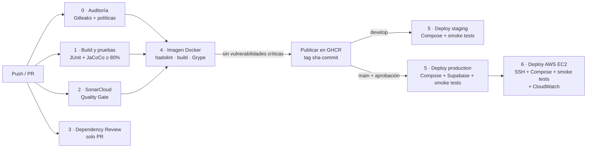
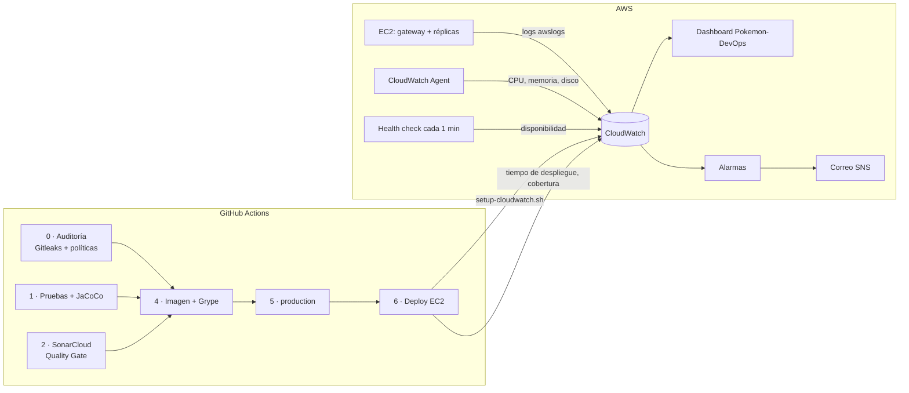

# Microservicio Pokémon


## 1. Descripción

Microservicio CRUD de Pokémon desarrollado con Spring Boot.

El repositorio forma parte de las evaluaciones de la asignatura **Ingeniería DevOps**:

* **Evaluación Parcial N°1:** control de versiones, estrategia de branching (GitFlow) y CI básica.
* **Evaluación Parcial N°2:** pipeline CI/CD completo en GitHub Actions con contenedores, pruebas automatizadas, análisis de seguridad, despliegue automático (entorno simulado y AWS EC2), base de datos en la nube con Supabase y orquestación con Docker Compose (secciones 10 a 18).
* **Evaluación Parcial N°3:** observabilidad con AWS CloudWatch (logs, métricas, alarmas y dashboard), métricas del pipeline y políticas de cumplimiento automatizadas que detienen el pipeline ante fallas (secciones 19 a 24).

**Aplicación desplegada en AWS EC2:**

* API: http://52.6.20.105/api/pokemons
* Swagger: http://52.6.20.105/swagger-ui.html
* Versión desplegada: http://52.6.20.105/actuator/info

> La instancia corre en un laboratorio de AWS Academy, que se apaga cuando termina la sesión. Si la URL no responde, el laboratorio está detenido; la evidencia de cada despliegue queda en *Actions* y en *Deployments*.

---

## 2. Integrantes

* Nombre: Diego Araya
* Nombre: Leonardo Mendez
* Nombre: Cristopher López

---

## 3. Tecnologías utilizadas

* Java 21 / Spring Boot 3.5 / Maven
* PostgreSQL: Supabase (nube) en production y AWS EC2; contenedor PostgreSQL 16 en local y staging
* JUnit 5, Mockito, MockMvc y JaCoCo (pruebas y cobertura)
* Docker (imagen multi-stage) y Docker Compose (orquestación)
* Nginx (gateway y balanceador de carga)
* GitHub Actions (CI/CD) y GitHub Container Registry (GHCR)
* SonarCloud (análisis estático), Dependabot y Grype (seguridad de dependencias e imagen)
* AWS CloudWatch (logs, métricas, alarmas y dashboard), CloudWatch Agent y SNS
* Gitleaks y script propio de auditoría (políticas de cumplimiento)
* Swagger / OpenAPI
* Git / GitHub

---


# 4. Estrategia de branching

Para el desarrollo colaborativo se utilizamos GitFlow, este nos permitio colaborar en distintas ramas. mientras unos subian el codigo base, el otro desarrollaba otra funcionalidad.
Se eligió GitFlow en lugar de Trunk-Based Development debido a que el proyecto requiere una separación clara entre el código estable y el código en desarrollo,

La estructura utilizada será:

main
│
└── develop
    ├── feature/getbyname
    ├── feature/deletebyname
    └── hotfix/errordeprueba
    └── hotfix/endpoints-duplicados


### Ramas principales

#### `main`

Contiene la versión base y ejecutable del proyecto.

Los cambios hacia main se realizan mediante Pull Requests desde la rama develop y deben ser revisados (github tiene un compilador para probar que no haya conflicto de codigo) antes de realizar el merge.

#### `develop`

Contiene la versión de desarrollo donde se integran las nuevas funcionalidades desde las ramas features mediane pull request

#### `feature/nombrefuncionalidad`

Se utiliza para desarrollar nuevas funcionalidades.

Ejemplos:
feature/gebyname
feature/deletebyname
feaure/swagger


Una vez terminada la funcionalidad, se crea un Pull Request hacia la rama develop.

#### `hotfix/<nombre>`

Se utiliza para solucionar errores criticos de manera rapida y se integra mediante pull request a la rama correspondiente.
Generalmente se integra en varias ramas para corregir el error, por ejemplo primero se hace el pullrequest al feature y luego al develop.

Ejemplos:
hotfix/errortipeo
hotfix/errorversion
hotfix/errorcodigoduplicado


Los cambios del hotfix deben ser revisados mediante Pull Request antes de integrarse a la rama correspondiente.

---

# 5. Convención de nombres de ramas

Se utilizará la siguiente nomenclatura:

feature/<funcionalidad>
hotfix/<error>


Los nombres deben:

* Estar escritos en minúsculas.
* Utilizar palabras descriptivas.
* Separar palabras mediante `-`.
* Indicar claramente el objetivo del cambio.

Ejemplos:

feature/create-pokemon
feature/delete-pokemon
hotfix/errorcontroller
hotfix/fix-delete-mapping


---

# 6. Convención de commits

Se utilizará una convención basada en Conventional Commits.

Formato:

tipo: descripción

Tipos principales:

  feat      Nueva funcionalidad                
  fix       Corrección de errores              


Ejemplos:

feat: agregar endpoint para eliminar pokemon

fix: corregir mapping de delete por nombre


Los mensajes de commit deben ser claros, breves y describir el cambio realizado.

---

# 7. Flujo de trabajo

El flujo de trabajo definido para el proyecto será:


feature/<funcionalidad>
       ↓
     develop
       ↓
      main


Para desarrollar una nueva funcionalidad:

1. Crear una rama feature/<funcionaliadad> desde develop.
2. Realizar los cambios necesarios.
3. Crear commits descriptivos.
4. Realizar `push` de la rama a GitHub.
5. Crear un Pull Request hacia `develop`.
6. Realizar la revisión del código.
7. Corregir las observaciones realizadas durante la revisión.
8. Aprobar el Pull Request.
9. Realizar el merge hacia `develop`.

Para una corrección urgente:


hotfix/<error>
       ↓
     develop


El hotfix debe ser revisado mediante Pull Request antes de integrarse.

---

# 8. Pull Requests

Todos los cambios realizados mediante ramas `feature` y `hotfix` deben integrarse utilizando Pull Requests.

Cada Pull Request debe contener:

* Título descriptivo.
* Descripción del cambio realizado.
* Rama de origen.
* Rama de destino.
* Revisión por otro integrante del equipo.

No se deben realizar cambios directamente sobre `main`.

---

# 9. Estrategia de revisión

La revisión de código se realizará mediante **Pull Requests de GitHub**.

El integrante que no desarrolló directamente el cambio deberá revisar el Pull Request.

Durante la revisión se verificará:

* Funcionamiento del código.
* Cumplimiento de las convenciones de commits.
* Correcta nomenclatura de ramas.
* Calidad y legibilidad del código.
* Ausencia de errores evidentes.
* Correcta implementación de la funcionalidad.

Si existen observaciones, estas deberán ser corregidas antes de realizar el merge.

---

# 10. Pipeline CI/CD (GitHub Actions)

El pipeline está definido en `.github/workflows/ci-cd.yml` y el despliegue en el workflow reutilizable `.github/workflows/deploy.yml`.

## 10.1 Disparadores

| Evento | Qué se ejecuta |
|---|---|
| Pull Request hacia `develop` o `main` | Build y pruebas, SonarCloud, revisión de dependencias y build + escaneo de la imagen (no se publica ni se despliega) |
| Push / merge a `develop` | Build y pruebas, imagen Docker con escaneo y **despliegue automático en `staging`** (2 réplicas). SonarCloud ya se ejecutó en el PR. |
| Push / merge a `main` | Pipeline completo, **despliegue en `production`** (3 réplicas, Supabase) previa **aprobación manual**, y luego **despliegue en AWS EC2** (2 réplicas, Supabase) |
| Manual (`workflow_dispatch`) | Pipeline completo sobre la rama elegida |

## 10.2 Etapas



### Por qué algunos jobs aparecen como omitidos (skipped)

Un job omitido no es un error: el pipeline ejecuta solo lo que corresponde según el origen del cambio.

| Job omitido | Cuándo | Motivo |
|---|---|---|
| 2 · SonarCloud | Push a `develop` | El plan gratuito solo analiza `main` y los PRs. Ese código ya pasó el Quality Gate en su PR. |
| 2 · SonarCloud | PRs de Dependabot | GitHub no entrega secrets (el token de Sonar) a Dependabot. Igual pasan pruebas, revisión de dependencias y Grype. |
| 3 · Revisión de dependencias | Push a `develop` / `main` | Compara los cambios de un PR; fuera de un PR no hay con qué comparar. |
| Publicación de la imagen (job 4) | Pull Requests | En un PR la imagen se construye y escanea, pero no se publica hasta que el cambio se integra. |
| 5 · Deploy staging / production | Ramas que no corresponden | Staging solo desde `develop`; production solo desde `main`. |
| 6 · Deploy AWS EC2 | Si production no terminó bien | Solo se despliega en AWS lo que pasó production. Si faltan `EC2_HOST`/`EC2_SSH_KEY`, se omite con un aviso. |

| # | Job | Indicador | Qué hace | Bloquea si... |
|---|---|---|---|---|
| 1 | Build y pruebas unitarias | IE2 | `mvn verify`: compila, ejecuta las pruebas JUnit, genera el reporte JaCoCo y verifica la cobertura mínima. Publica los reportes y el JAR como artefactos. | falla una prueba o la cobertura de líneas es menor a 80 % |
| 2 | Análisis SonarCloud | IE3 | Análisis estático (bugs, vulnerabilidades, code smells, security hotspots y cobertura) y espera el resultado del Quality Gate. Corre en cada PR y en cada push a `main`. El plan gratuito de SonarCloud no analiza otras ramas, pero todo lo que entra a `develop` ya pasó el Quality Gate en su PR. | el Quality Gate no se aprueba |
| 3 | Revisión de dependencias | IE3 | En cada PR compara las dependencias nuevas contra la base de vulnerabilidades de GitHub. | se agrega una dependencia con vulnerabilidad alta o crítica |
| 4 | Imagen Docker | IE1, IE3, IE4 | Lint del Dockerfile (hadolint), construcción de la imagen, escaneo con Grype, publicación en GHCR con SBOM y procedencia. | hay errores en el Dockerfile o vulnerabilidades críticas con parche disponible |
| 5 | Deploy staging / production | IE4, IE5 | Levanta el stack completo con Docker Compose usando la imagen publicada, ejecuta smoke tests y una prueba de autorrecuperación, y registra la trazabilidad. | el stack no queda sano o falla algún smoke test |
| 6 | Deploy AWS EC2 | IE4, IE5 | Después de production, copia la configuración a la instancia EC2 por SSH, instala Docker si falta, descarga la imagen exacta desde GHCR, levanta el stack con Docker Compose y ejecuta los smoke tests contra la IP pública. Si los secrets de EC2 no existen, se omite con un aviso. | el stack no queda sano en la instancia o falla algún smoke test |

Cada job depende del anterior (`needs`): si una etapa falla, las siguientes no se ejecutan y la imagen **no** se publica ni se despliega.

---

# 11. Contenerización (Dockerfile)

El `Dockerfile` es **multi-stage**:

1. **build** (`maven:3.9-eclipse-temurin-21`): descarga dependencias (capa cacheada si `pom.xml` no cambia) y compila el JAR.
2. **extract**: separa el JAR en capas de Spring Boot (dependencias, loader y código de la aplicación).
3. **runtime** (`eclipse-temurin:21-jre-alpine`): solo JRE y las capas extraídas.

Características:

* La imagen final no contiene JDK, Maven ni código fuente.
* Corre con un **usuario sin privilegios** (UID 10001).
* Tiene un `HEALTHCHECK` sobre `/actuator/health/liveness`.
* La JVM se ajusta a los límites de memoria del contenedor (`MaxRAMPercentage=75`) y se reinicia limpiamente ante un `OutOfMemoryError`.
* Lleva labels OCI (`org.opencontainers.image.revision`, `version`, `created`) con el commit de origen.
* Un `.dockerignore` excluye `.git`, `.env`, `target/` y otros archivos del contexto de build.

Construir y ejecutar solo la imagen:

```bash
docker build -t pokemon-service:local --build-arg GIT_COMMIT=$(git rev-parse HEAD) .
```

---

# 12. Orquestación con Docker Compose

`docker-compose.yml` define el stack completo:

```
             puerto 8080
cliente ───────► gateway (Nginx) ──┬──► app réplica 1 ──┐
                 red frontend      ├──► app réplica 2 ──┼──► db (PostgreSQL 16)
                                   └──► app réplica N ──┘
                                    red backend (interna, sin salida a Internet)
```

| Servicio | Imagen | Rol |
|---|---|---|
| `gateway` | `nginxinc/nginx-unprivileged:1.28-alpine` | Único punto de entrada. Balancea con `least_conn` entre las réplicas, reintenta en otra réplica si una falla, limita la tasa por IP (20 req/s), agrega cabeceras de seguridad y solo expone `health` e `info` del actuator. |
| `app` | `ghcr.io/<repo>:sha-<commit>` o build local | Microservicio. Tiene `APP_REPLICAS` réplicas (2 por defecto) y no publica puertos al host. |
| `db` | `postgres:16-alpine` | Base de datos con volumen persistente. Se inicializa con `schema.sql`. No es accesible desde fuera. |

**Escalabilidad:**

* Las réplicas se definen con `deploy.replicas`. Para escalar en caliente: `docker compose up -d --scale app=3 --wait`.
* Nginx detecta las nuevas réplicas mediante el DNS interno de Docker (`resolve`), sin reiniciarse.
* Cada contenedor tiene límites y reservas de CPU y memoria.
* El pool de conexiones a la base está acotado para que N réplicas no agoten las conexiones de PostgreSQL.

**Disponibilidad:**

* Cada servicio tiene healthcheck. `depends_on: condition: service_healthy` asegura el orden de arranque `db → app → gateway`.
* La política `restart: unless-stopped` reinicia los contenedores caídos.
* El apagado es graceful (`server.shutdown: graceful` y `stop_grace_period`).

**Seguridad de los contenedores:**

* Filesystem de solo lectura (`read_only` con `/tmp` en tmpfs).
* `cap_drop: ALL` y `no-new-privileges`.
* Procesos sin root.
* Red `backend` interna.
* Las credenciales se pasan por variables de entorno, nunca dentro de la imagen.
* Rotación de logs (10 MB × 3).

### Ejecución local

```bash
cp .env.example .env        # editar POSTGRES_PASSWORD
docker compose up -d --build --wait
./scripts/smoke-test.sh     # verificación rápida (requiere curl y jq)
```

* API: http://localhost:8080/api/pokemons
* Swagger: http://localhost:8080/swagger-ui.html
* Salud: http://localhost:8080/actuator/health
* Versión desplegada: http://localhost:8080/actuator/info

Para detener el stack: `docker compose down` (agregar `-v` para borrar también los datos).

---

# 13. Despliegue automático en entorno simulado

El workflow `deploy.yml` usa el runner de GitHub Actions como "servidor cloud" simulado:

1. Inicia sesión en GHCR y descarga la imagen **exacta** que pasó las pruebas y el escaneo (`sha-<commit>`). La imagen no se reconstruye.
2. Genera una contraseña aleatoria para la base de datos (enmascarada en los logs) y la escribe en un `.env` temporal.
3. Ejecuta `docker compose up --no-build --wait`, que espera a que todos los servicios estén sanos.
4. Ejecuta `scripts/smoke-test.sh`, que verifica:
   * la salud del servicio;
   * que el commit expuesto en `/actuator/info` sea el mismo que disparó el pipeline;
   * el CRUD completo de punta a punta, incluida la validación (400) y el 404;
   * que el gateway reparta carga entre todas las réplicas.
5. **Prueba de autorrecuperación:** elimina una réplica, comprueba que la API sigue respondiendo y que Compose restaura el número de réplicas.
6. Publica un resumen del despliegue y los logs de los contenedores como artefacto, y apaga el entorno.

Los entornos `staging` y `production` quedan registrados en **GitHub → Environments / Deployments**, con su historial de despliegues.

**Aprobación manual:** el entorno `production` tiene la regla *Required reviewers*. Cuando el pipeline llega a producción se detiene en *Waiting for review* hasta que un integrante lo aprueba (*Review deployments → Approve and deploy*). Queda registrado quién aprobó y cuándo.

**Base de datos:** `production` usa Supabase (PostgreSQL en la nube) combinando `docker-compose.yml` con `docker-compose.supabase.yml`, que solo cambia las variables de conexión. `staging` usa un PostgreSQL en contenedor con datos desechables, para no ensuciar los datos reales.

## 13.1 Despliegue en AWS EC2

Después de `production`, el job **6 · Deploy AWS EC2** despliega en una instancia real del laboratorio AWS Academy:

| Recurso | Configuración |
|---|---|
| Instancia | `pokemon-server`, Amazon Linux 2023, t3.small, 20 GiB gp3 |
| Red | Elastic IP `52.6.20.105`; security group `pokemon-sg` con los puertos 22 (SSH) y 80 (HTTP) |
| Acceso | Llave `pokemon-key.pem`, guardada solo en el secret `EC2_SSH_KEY` |
| Base de datos | Supabase (proyecto `pokemon-ep2`, Session pooler, región us-east-1) |

Pasos del job:

1. Se conecta por SSH con los secrets `EC2_HOST` y `EC2_SSH_KEY`.
2. Copia a `~/pokemon` los archivos de despliegue (`docker-compose.yml`, `docker-compose.supabase.yml`, `schema.sql`, configuración de Nginx y `scripts/ec2-deploy.sh`).
3. Envía las credenciales de Supabase por stdin (no quedan en los logs ni en el repositorio).
4. `ec2-deploy.sh` instala Docker y Docker Compose si faltan, descarga desde GHCR la imagen **exacta** que pasó las pruebas y el escaneo, y levanta el stack con `docker compose up --wait`.
5. Ejecuta los smoke tests contra `http://52.6.20.105` y registra la trazabilidad en el *Job Summary*.

Revisar el stack directamente en la instancia:

```bash
ssh -i pokemon-key.pem ec2-user@52.6.20.105
cd ~/pokemon
sudo docker compose -f docker-compose.yml -f docker-compose.supabase.yml ps
```

Al cambiar de instancia (nuevo laboratorio) basta con actualizar los secrets `EC2_HOST` y `EC2_SSH_KEY`; el código no cambia.

---

# 14. Trazabilidad y calidad

### Trazabilidad (desde el commit hasta lo desplegado)

| Elemento | Cómo se vincula al commit |
|---|---|
| Imagen Docker | Tag inmutable `sha-<7 caracteres>`, más los tags `develop`/`main`/`latest` |
| Contenido de la imagen | Labels OCI `revision` y `created`, SBOM y attestation de procedencia (build provenance) en GHCR |
| Aplicación en ejecución | `/actuator/info` muestra `commit`, `version` y `environment`. Los smoke tests verifican que coincida con el commit del pipeline. |
| Reportes | Artefactos `test-reports-<sha>`, `pokemon-service-jar-<sha>` y `deploy-logs-<entorno>-<sha>` (30 días) |
| Despliegues | GitHub Environments (quién, cuándo, qué commit) y la tabla en el *Job Summary* de cada ejecución (commit, imagen, digest, réplicas, autor) |
| Cambios de código | GitFlow con Pull Requests y Conventional Commits (secciones 4 a 9) |

### Calidad y seguridad

* **Pruebas automatizadas** (JUnit 5 + Mockito + MockMvc):
  * `PokemonServiceTest`: lógica de negocio, incluidos los casos de "no encontrado".
  * `PokemonControllerTest`: códigos HTTP, validaciones (400), errores 404/500 y formato de respuesta.
* **Política de cobertura:** JaCoCo exige al menos **80 % de líneas** (configurable en `pom.xml`, propiedad `jacoco.minimum.line.coverage`). Se excluyen DTOs, entidades y configuración.
* **Análisis estático:** Quality Gate de SonarCloud obligatorio.
* **Dependencias:**
  * Dependabot revisa cada semana Maven, imágenes Docker, Docker Compose y GitHub Actions, y abre PRs hacia `develop`.
  * Dependency Review bloquea los PRs que agreguen dependencias vulnerables.
* **Cadena de suministro del pipeline:** las acciones de terceros (Docker, Anchore) están fijadas por hash de commit y no por etiqueta, para que nadie pueda cambiar su código sin que se note (Dependabot las mantiene actualizadas). Los valores dinámicos se pasan a los comandos como variables de entorno para evitar inyección de comandos.
* **Imagen:** hadolint para buenas prácticas del Dockerfile y Grype para vulnerabilidades. Las críticas con parche bloquean la publicación; el resto queda como **alerta** en *Security → Code scanning*.
* **Alertas:** cuando un job falla, GitHub notifica por correo al autor del commit. Los hallazgos de seguridad aparecen en la pestaña *Security* y los de SonarCloud en su panel (y como comentario en el PR).
* **Secretos:**
  * Se eliminaron las credenciales por defecto de `application.yml`.
  * Los secretos se gestionan con GitHub Secrets y `.env` (ignorado por Git).
  * Los permisos del `GITHUB_TOKEN` son mínimos, definidos por job.

---

# 15. Configuración necesaria en GitHub

Pasos previos para que el pipeline funcione:

1. **SonarCloud**
   1. Ingresar a https://sonarcloud.io con la cuenta de GitHub e importar el repositorio.
   2. En el proyecto: *Administration → Analysis Method* → desactivar **Automatic Analysis** (el análisis lo hace el pipeline).
   3. *My Account → Security* → generar un token.
   4. En GitHub (*Settings → Secrets and variables → Actions*):
      * **Secret** `SONAR_TOKEN`: el token generado.
      * **Variable** `SONAR_ORGANIZATION`: la key de la organización en SonarCloud.
      * **Variable** `SONAR_PROJECT_KEY`: la key del proyecto (por ejemplo `usuario_Pokemon-Microservicio`).
2. **Dependabot:** en *Settings → Code security* activar *Dependency graph*, *Dependabot alerts* y *Dependabot security updates*. Las actualizaciones de versión se configuran en `.github/dependabot.yml`.
3. **Environments** (*Settings → Environments*): crear `staging` y `production`. En `production` se configuró *Required reviewers* para exigir una aprobación manual antes de desplegar.
4. **Protección de ramas** (*Settings → Rules → Rulesets*) para `main` y `develop`: exigir PR con 1 aprobación, bloquear *force push* y borrado, y exigir que pasen los checks `0 · Auditoría de cumplimiento`, `1 · Build y pruebas unitarias`, `2 · Análisis SonarCloud (Quality Gate)` y `4 · Imagen Docker (build, escaneo, publicación)`.
5. **AWS EC2 (laboratorio AWS Academy)**
   * **Secret** `EC2_HOST`: IP pública de la instancia.
   * **Secret** `EC2_SSH_KEY`: contenido completo de la llave privada `.pem` (desde `-----BEGIN` hasta `-----END`).
   * **Variable** `EC2_USER` (opcional): `ec2-user` en Amazon Linux (valor por defecto) o `ubuntu` en Ubuntu.
   * **Variable** `EC2_APP_REPLICAS` (opcional): réplicas en la instancia (por defecto 2).
   * Security group con entrada **22 (SSH)** y **80 (HTTP)** abiertas. Instancia **x86_64** con al menos **2 GB de RAM** (t3.small o mayor); con 1 GB usar `EC2_APP_REPLICAS=1`.
   * Al cambiar la instancia (nuevo laboratorio) basta con actualizar `EC2_HOST` y `EC2_SSH_KEY`.
   * **Rol IAM `LabInstanceProfile`** asignado a la instancia (*EC2 → Actions → Security → Modify IAM role*): lo usa CloudWatch (sección 20).
   * **Secret** `ALERT_EMAIL` (opcional): correo que recibe las alarmas de CloudWatch.
6. **Supabase (base de datos en la nube para production y EC2)**
   * Crear el proyecto en https://supabase.com y ejecutar `schema.sql` en el **SQL Editor**.
   * En **Connect → Session pooler** copiar host, usuario y puerto (el pooler funciona por IPv4, la conexión directa no).
   * **Secret** `SUPABASE_DB_URL`: `jdbc:postgresql://<host-del-pooler>:5432/postgres?sslmode=require`
   * **Secret** `SUPABASE_DB_USER`: `postgres.<id-del-proyecto>`
   * **Secret** `SUPABASE_DB_PASSWORD`: la clave de la base.
   * Staging y el entorno local siguen usando PostgreSQL en contenedor (datos de prueba desechables). Si faltan estos secrets, production y EC2 también usan PostgreSQL local y el pipeline lo advierte.

**Resumen de secrets del repositorio:**

| Secret | Para qué sirve |
|---|---|
| `EC2_HOST` | IP pública de la instancia EC2 (a qué servidor se conecta el pipeline) |
| `EC2_SSH_KEY` | Llave privada SSH (`.pem`) para entrar a la instancia sin contraseña |
| `SONAR_TOKEN` | Token de SonarCloud para enviar el análisis y consultar el Quality Gate |
| `SUPABASE_DB_URL` | Dirección JDBC de la base de datos en Supabase |
| `SUPABASE_DB_USER` | Usuario de la base de datos |
| `SUPABASE_DB_PASSWORD` | Contraseña de la base de datos |
| `ALERT_EMAIL` | Correo que recibe las alarmas de CloudWatch (EP3) |

GitHub guarda los secrets cifrados y los oculta como `***` en los logs. El `GITHUB_TOKEN` (para publicar en GHCR) no se configura: GitHub lo genera en cada ejecución y expira al terminar.

---

# 16. Estructura del repositorio

```
.
├── .github/
│   ├── dependabot.yml          # actualizaciones automáticas de dependencias
│   └── workflows/
│       ├── ci-cd.yml           # pipeline principal
│       └── deploy.yml          # despliegue reutilizable (staging / production)
├── deploy/
│   └── nginx/default.conf      # gateway / balanceador (log de accesos en JSON)
├── monitoring/                 # EP3: observabilidad en AWS CloudWatch
│   ├── setup-cloudwatch.sh     # agente, logs, filtros, alarmas y dashboard (idempotente)
│   ├── cloudwatch-agent.json   # métricas de CPU, memoria y disco
│   ├── pokemon-healthcheck.sh  # disponibilidad y uso de las réplicas cada minuto
│   ├── publicar-metricas-cicd.sh # métricas del pipeline (tiempo de despliegue, cobertura)
│   └── dashboard.json          # dashboard Pokemon-DevOps como código
├── scripts/
│   ├── smoke-test.sh           # verificación post-despliegue (bash, usado por el pipeline)
│   ├── smoke-test.ps1          # misma verificación para Windows / PowerShell
│   ├── ec2-deploy.sh           # despliegue en la instancia AWS EC2 (lo ejecuta el job 6)
│   └── audit-compliance.sh     # EP3: auditoría de políticas de cumplimiento (job 0)
├── src/
│   ├── main/java/com/pokemon/  # controller, service, repository, dto, entity, exception
│   └── test/java/com/pokemon/  # PokemonServiceTest, PokemonControllerTest
├── Dockerfile                  # imagen multi-stage
├── .dockerignore
├── docker-compose.yml          # orquestación: gateway + réplicas + PostgreSQL
├── docker-compose.supabase.yml # variante: la app usa la base de Supabase
├── docker-compose.cloudwatch.yml # variante AWS: logs de los contenedores a CloudWatch
├── .gitleaks.toml              # EP3: política de secretos (Gitleaks)
├── .env.example                # plantilla de variables (copiar a .env)
├── .gitattributes              # fin de línea LF para scripts y configuración
├── schema.sql                  # tabla, datos iniciales y secuencia
└── pom.xml                     # dependencias, JaCoCo y propiedades de Sonar
```

---

# 17. Ejecución del proyecto sin contenedores

Requisitos: Java 21, Maven y acceso a una base de datos PostgreSQL configurada en `.env` (ver `.env.example`).

```bash
git clone <URL_DEL_REPOSITORIO>
cd <NOMBRE_DEL_REPOSITORIO>
mvn spring-boot:run
```

Ejecutar las pruebas con el reporte de cobertura:

```bash
mvn verify
# reporte HTML: target/site/jacoco/index.html
```

---

# 18. API

La API permite realizar operaciones CRUD sobre Pokémon.

```
GET     /api/pokemons
GET     /api/pokemons/{id}
GET     /api/pokemons/name/{name}
POST    /api/pokemons
PUT     /api/pokemons/{id}
DELETE  /api/pokemons/{id}
DELETE  /api/pokemons/name/{name}
```

La documentación de la API se puede consultar con Swagger/OpenAPI en `/swagger-ui.html` (en AWS: http://52.6.20.105/swagger-ui.html). Los endpoints aparecen agrupados bajo la sección **Pokedex**.

---

# 19. Evaluación Parcial N°3: observabilidad y cumplimiento

La EP3 extiende el pipeline de la EP2 con **monitoreo, métricas y políticas de cumplimiento automatizadas**:

| Punto de la pauta | Implementación | Sección |
|---|---|---|
| 1. Monitoreo (IE1) | AWS CloudWatch: logs de los contenedores, CloudWatch Agent, health check y alarmas | 20 |
| 2. Orquestación en Kubernetes (IE2) | **No aplica:** por indicación del docente este punto no se realiza (Kubernetes no se vio en la asignatura). La orquestación sigue con Docker Compose (secciones 12 y 13). | — |
| 3. Dashboard (IE3) | Dashboard de CloudWatch `Pokemon-DevOps`, definido como código | 21 |
| 4. Políticas de cumplimiento (IE5) | SonarCloud (SonarQube), reglas de protección de ramas, Gitleaks y script de auditoría | 22 |
| 5. Integración y toma de decisiones (IE4) | Este README (secciones 20 a 24) | 24 |
| 6. El pipeline se detiene ante fallas (IE6) | Validaciones bloqueantes en cada etapa | 23 |



---

# 20. Monitoreo con AWS CloudWatch (IE1)

Todo se configura **automáticamente en cada despliegue a AWS** (job `6 · Deploy AWS EC2`), con el script `monitoring/setup-cloudwatch.sh` que se ejecuta en la instancia. No se usan llaves de AWS: la instancia tiene asignado el rol IAM **`LabInstanceProfile`** del laboratorio, y Docker, el agente y la AWS CLI usan ese rol.

## 20.1 Logs

Los contenedores usan el driver **`awslogs`** de Docker (`docker-compose.cloudwatch.yml`), que envía cada línea de log a CloudWatch Logs:

| Grupo de logs | Contenido | Retención |
|---|---|---|
| `/pokemon/app` | Logs de Spring Boot con nivel (`INFO`, `WARN`, `ERROR`) y clase. Un *stream* por réplica (`pokemon-app-1`, `pokemon-app-2`) | 7 días |
| `/pokemon/gateway` | Accesos de Nginx en **JSON** (método, ruta, status, tiempo de respuesta, réplica que atendió) | 7 días |
| `/pokemon/db` | PostgreSQL local (solo si no se usa Supabase) | 7 días |

Para dejar los logs listos para el análisis se hicieron dos cambios en la aplicación:

* `application.yml`: el patrón de log ahora incluye el **nivel** y la clase (`2026-11-26 10:00:00.123 ERROR [hilo] clase - mensaje`).
* `GlobalExceptionHandler`: los errores 500 se registran como `ERROR` con su stack trace y los 404 como `WARN`.

## 20.2 Métricas

| Métrica (namespace) | Origen | Qué mide |
|---|---|---|
| `cpu_usage_active`, `mem_used_percent`, `used_percent` (`Pokemon/EC2`) | CloudWatch Agent (`monitoring/cloudwatch-agent.json`) | CPU, memoria y disco de la instancia. La memoria no viene por defecto en EC2, por eso se instala el agente. |
| `CPUUtilization` (`AWS/EC2`) | EC2 | CPU de la instancia (métrica nativa) |
| `CPUContenedoresApp`, `MemoriaContenedoresAppMB` (`Pokemon/App`) | Health check (`docker stats`) | Recursos que consumen las réplicas del microservicio |
| `Disponibilidad`, `TiempoRespuestaMs`, `ReplicasSanas` (`Pokemon/App`) | Health check cada minuto (`monitoring/pokemon-healthcheck.sh`, timer de systemd) | Si `/actuator/health` responde 200 (1) o no (0), cuánto tarda y cuántas réplicas están sanas |
| `ErroresApp`, `AdvertenciasApp` (`Pokemon/App`) | Filtros de métricas sobre `/pokemon/app` | Líneas `ERROR` y `WARN` registradas por la aplicación |
| `Peticiones`, `Errores5xx`, `Errores4xx`, `LatenciaGateway` (`Pokemon/App`) | Filtros de métricas sobre `/pokemon/gateway` (JSON) | Tráfico, errores HTTP y latencia de cada petición |

## 20.3 Alarmas

Las alarmas notifican por correo mediante el tema SNS `pokemon-alertas` (correo definido en el secret `ALERT_EMAIL`; hay que confirmar la suscripción la primera vez):

| Alarma | Condición |
|---|---|
| `Pokemon-Disponibilidad` | El health check falla 2 minutos seguidos |
| `Pokemon-Errores5xx` | 5 o más respuestas 5xx en 5 minutos |
| `Pokemon-ErroresApp` | 5 o más líneas `ERROR` en 5 minutos |
| `Pokemon-CPU-Alta` | CPU sobre 80 % durante 10 minutos |
| `Pokemon-Memoria-Alta` | Memoria sobre 85 % durante 10 minutos |

## 20.4 Revisar el monitoreo

* **Consola de AWS:** *CloudWatch → Log groups → `/pokemon/app`* (logs), *All metrics → Pokemon/App* (métricas), *Alarms* y *Dashboards → Pokemon-DevOps*.
* **Logs Insights** (*CloudWatch → Logs Insights*, grupo `/pokemon/app`):

```
fields @timestamp, @logStream, @message
| filter @message like /ERROR/
| sort @timestamp desc
| limit 20
```

* **En la instancia:** `systemctl status pokemon-healthcheck.timer` y `journalctl -u pokemon-healthcheck -n 5` muestran la última medición.

Si la instancia no tiene rol IAM, el script lo advierte en el pipeline y el despliegue continúa con logs locales (no se rompe la entrega).

---

# 21. Dashboard de métricas (IE3)

El dashboard **`Pokemon-DevOps`** está definido como código en `monitoring/dashboard.json`. El pipeline lo crea o actualiza en cada despliegue (`aws cloudwatch put-dashboard`), así cualquier cambio queda versionado en Git.

| Fila | Widgets |
|---|---|
| Valores actuales | Disponibilidad, réplicas sanas, **cobertura de pruebas**, **tiempo de despliegue**, duración del pipeline, **errores de la última hora** |
| Recursos | **CPU** (instancia y réplicas), **memoria** y disco, disponibilidad y tiempo de respuesta |
| Errores y tráfico | **Errores registrados** (ERROR, 5xx, 4xx, WARN), peticiones y latencia p90, estado de las alarmas |
| CI/CD (30 días) | Tiempo de despliegue y duración del pipeline por ejecución; cobertura de líneas y ramas con la línea del mínimo (80 %); resultado de cada despliegue |
| Logs | Tabla con los últimos 20 errores de la aplicación y la réplica que los generó |

**Integración con CI/CD:** al final del job `6 · Deploy AWS EC2`, el pipeline publica en el namespace `Pokemon/CICD` las métricas de esa ejecución (`monitoring/publicar-metricas-cicd.sh`):

| Métrica | Cómo se obtiene |
|---|---|
| `TiempoDespliegue` (s) | Duración del despliegue en EC2: copia de archivos, configuración, `docker compose up` y smoke tests |
| `DuracionPipeline` (min) | Desde que empezó la ejecución hasta el fin del despliegue (incluye la aprobación manual de production) |
| `CoberturaPruebas`, `CoberturaRamas` (%) | Reporte de JaCoCo del job 1 |
| `PruebasTotales` | Pruebas JUnit ejecutadas en el job 1 |
| `DespliegueExitoso` (1/0) | Resultado del job de despliegue |

Los mismos valores quedan en el *Job Summary* de cada ejecución en GitHub Actions.

---

# 22. Políticas de cumplimiento y auditoría automatizada (IE5)

| Política | Herramienta | Dónde se aplica | Qué exige |
|---|---|---|---|
| Calidad y seguridad del código | **SonarCloud** (SonarQube en la nube), Quality Gate | Job 2, en cada PR y en `main` | Sin bugs ni vulnerabilidades nuevas, *security hotspots* revisados, cobertura y duplicación dentro de los umbrales del Quality Gate |
| Cobertura mínima | JaCoCo (`jacoco:check`) | Job 1 | Al menos 80 % de líneas cubiertas |
| Sin secretos en el código | **Gitleaks** (`.gitleaks.toml`) | Job 0 | No puede haber llaves de AWS, tokens, llaves privadas ni contraseñas en los archivos |
| Políticas del repositorio | **Script de auditoría** `scripts/audit-compliance.sh` | Job 0 | Ver tabla siguiente |
| Dependencias seguras | Dependency Review + Dependabot | Job 3 (PR) | Ninguna dependencia nueva con vulnerabilidad alta o crítica |
| Imagen segura | hadolint + Grype | Job 4 | Dockerfile sin errores; sin vulnerabilidades críticas con parche |
| Flujo de cambios controlado | **Reglas de protección de ramas** (*rulesets*) en `main` y `develop` | GitHub | PR obligatorio con 1 aprobación, checks obligatorios en verde, sin *force push* ni borrado de la rama |
| Aprobación de producción | GitHub Environment `production` | Job 5 | Revisión manual antes de desplegar |

**Políticas del script de auditoría** (cada ejecución deja la tabla de resultados en el *Job Summary*):

| Código | Política |
|---|---|
| P1 | No hay archivos `.env`, `.pem`, llaves ni credenciales versionados |
| P2 | `.gitignore` ignora `.env` y `*.pem` |
| P3 | `application.yml` no tiene contraseñas fijas |
| P4 | La imagen final corre con un usuario sin privilegios |
| P5 | Las imágenes base tienen versión fija (sin `:latest`) |
| P6 | La imagen define `HEALTHCHECK` (aviso) |
| P7 | Ningún contenedor corre en modo privilegiado |
| P8 | Solo el gateway publica puertos; app y base de datos quedan en red interna |
| P9 | La cobertura mínima configurada es al menos 80 % |
| P10 | El pipeline no usa `pull_request_target` |
| P11 | Cada workflow define permisos mínimos (`permissions`) |
| P12 | Existen los archivos obligatorios del proyecto |

Ejecutar la auditoría localmente: `bash scripts/audit-compliance.sh`.

---

# 23. Validaciones que detienen el pipeline (IE6)

Cada validación termina el job con error. Como los jobs siguientes dependen de él, **no se construye ni publica la imagen y no se despliega en ningún entorno**: el entorno productivo queda protegido.

| Falla crítica | Quién la detecta | Job que se detiene | Qué queda sin ejecutar |
|---|---|---|---|
| Secreto en el código (llave, token, contraseña) | Gitleaks | 0 · Auditoría | Imagen, publicación y despliegues |
| Política incumplida (p. ej. `.pem` en el repo, contenedor como root) | `audit-compliance.sh` | 0 · Auditoría | Imagen, publicación y despliegues |
| Prueba fallida o cobertura bajo 80 % | JUnit / JaCoCo | 1 · Build y pruebas | Imagen, publicación y despliegues |
| Quality Gate de SonarCloud no aprobado | SonarCloud | 2 · SonarCloud | Imagen, publicación y despliegues |
| Dependencia nueva con vulnerabilidad alta | Dependency Review | 3 · Dependencias | El PR no se puede fusionar (check obligatorio) |
| Vulnerabilidad crítica en la imagen | Grype | 4 · Imagen Docker | Publicación en GHCR y despliegues |
| La aplicación desplegada no funciona | Smoke tests | 5 / 6 · Deploy | Los entornos siguientes (production, EC2) |

Además, las **reglas de protección de ramas** impiden fusionar un PR a `main` o `develop` mientras algún check obligatorio esté en rojo.

## 23.1 Evidencia

Pruebas realizadas con Pull Requests que introducen fallas a propósito (se cerraron sin fusionar):

| Prueba | PR | Resultado |
|---|---|---|
| Secreto de prueba en el código | _#_ | _Pendiente: captura del job 0 en rojo y de los jobs siguientes omitidos_ |
| Prueba unitaria que falla | _#_ | _Pendiente_ |
| Código que no pasa el Quality Gate | _#_ | _Pendiente_ |
| Merge bloqueado por la protección de ramas | _#_ | _Pendiente_ |

---

# 24. Integración en el pipeline y toma de decisiones (IE4)

| Señal | Dónde se ve | Umbral configurado | Acción automática |
|---|---|---|---|
| Secretos / políticas del repo | Job 0 + *Job Summary* | Cualquier hallazgo | Se detiene el pipeline |
| Pruebas y cobertura | Job 1, artefacto `test-reports`, dashboard | < 80 % de líneas | Se detiene el pipeline |
| Calidad del código | SonarCloud y comentario en el PR | Quality Gate | Se detiene el pipeline / no se puede fusionar |
| Vulnerabilidades de la imagen | Job 4, pestaña *Security* | Crítica con parche | No se publica ni se despliega |
| Disponibilidad | Dashboard, alarma | 2 min sin responder | Correo de alarma |
| Errores registrados | Dashboard, Logs Insights, alarmas | 5 en 5 min (ERROR o 5xx) | Correo de alarma |
| CPU / memoria | Dashboard, alarmas | 80 % / 85 % por 10 min | Correo de alarma |
| Tiempo de despliegue y duración del pipeline | Dashboard (30 días), *Job Summary* | — (tendencia) | Se revisa por ejecución |

## 24.1 Cómo usamos estas métricas para tomar decisiones técnicas

_Pendiente: redactar por el equipo._

---

# 25. Justificación de decisiones técnicas

**¿Por qué Docker Compose y no Kubernetes?**

Usamos Docker Compose porque era suficiente para nuestro proyecto y nos permitía administrar los contenedores de forma sencilla. Kubernetes habría sido una solución más compleja de lo que necesitábamos.

**¿Por qué SonarCloud y Grype?**

Usamos SonarCloud para revisar la calidad y seguridad del código, mientras que Grype nos permitió buscar vulnerabilidades en las imágenes Docker. Ambas herramientas nos ayudan a detectar posibles problemas antes de desplegar la aplicación.

**¿Por qué hay aprobación manual en production y no en staging?**

Porque en producción necesitamos asegurarnos de que los cambios estén correctos antes de desplegarlos. En staging, en cambio, buscamos que las pruebas se realicen de forma más rápida y automática.

**¿Por qué Supabase en production, pero PostgreSQL local en staging?**

Usamos PostgreSQL local en staging para realizar pruebas sin afectar los datos de producción. En producción utilizamos Supabase porque nos facilita la administración de la base de datos y su disponibilidad.

**¿Por qué las contraseñas van en GitHub Secrets?**

Porque así evitamos dejar las contraseñas directamente en el código o en el repositorio. GitHub Secrets permite que el pipeline utilice esas credenciales de forma más segura cuando las necesita.

---

# 26. Declaración de uso de Inteligencia Artificial

Durante esta evaluación se utilizó **Claude (Anthropic)** como asistente en las siguientes partes del trabajo:

* Generación y corrección de los archivos de configuración del pipeline (`ci-cd.yml`, `deploy.yml`), el `Dockerfile`, `docker-compose.yml`, la configuración de Nginx y los scripts de smoke test y despliegue en EC2.
* Creación de pruebas unitarias adicionales (`PokemonControllerTest`) para alcanzar la cobertura mínima.
* Diagnóstico de errores del pipeline (Quality Gate de SonarCloud, vulnerabilidades detectadas por Grype, fallos de los smoke tests y de la conexión SSH).
* Guía paso a paso para configurar SonarCloud, Supabase, la instancia AWS EC2 y los GitHub Secrets.
* Redacción de las secciones técnicas 10 a 18 de este README.

**Validación:** todo el contenido generado fue ejecutado y verificado por el equipo: las pruebas se corrieron localmente (`mvn verify`), el stack se levantó con Docker Compose y se probó con los smoke tests, y el pipeline completo terminó en verde en GitHub Actions, incluido el despliegue en AWS EC2 con Supabase. Los errores que aparecieron se corrigieron y se volvieron a probar.

**Evaluación Parcial N°3:** se utilizó Claude (Anthropic) para:

* Generar la configuración de observabilidad (`docker-compose.cloudwatch.yml`, `monitoring/*`: agente de CloudWatch, health check, filtros de métricas, alarmas y dashboard) y los cambios al job de despliegue en EC2.
* Generar la auditoría de cumplimiento (`scripts/audit-compliance.sh`, `.gitleaks.toml` y el job `0 · Auditoría de cumplimiento`).
* Guía paso a paso para configurar CloudWatch, el rol IAM de la instancia y las reglas de protección de ramas.
* Redacción de las secciones técnicas 19 a 24 de este README, excepto la 24.1.

_Pendiente: describir cómo validó el equipo lo generado en la EP3 (pipeline en verde, capturas de CloudWatch, PRs de prueba)._

Las secciones 24.1 (uso de las métricas para decidir), 25 (justificación de decisiones técnicas) y 27 (conclusiones y reflexiones individuales) fueron escritas por el equipo sin apoyo de IA, según lo exige la pauta.

Referencia: Anthropic. (2026). *Claude* [Modelo de lenguaje de gran tamaño]. https://claude.ai

---

# 27. Conclusiones y reflexiones individuales

### Diego Araya

- **Lo que más costó:** Explicar las dificultades de implementar el cd, los problemas que pasaron en la configuración y como lo solucionamos
- **Lo que aprendí:** El como automatizar permite entender mejor la idea de integración y despliegue continuo, reduciendo la intervención manual
- **Qué mejoraría:** Un sistema de monitoreo de los recursos en AWS, se podría ver el consumo de la CPU, memoria y otros recursos, esto serviría para optimizar recursos

### Leonardo Méndez

- **Lo que más costó:** La configuración de SonarQube
- **Lo que aprendí:** El como las buenas practicas mejora la calidad de nuestro proyecto
- **Qué mejoraría:** Implementar ECS para la orquestación y administración de contenedores

### Cristopher López

- **Lo que más costó:** Docker, su configuración de entorno, las dependencias y errores durante la construcción
- **Lo que aprendí:** El como CI CD permite entender mejor la automatización de las pruebas, construcción de imágenes y el despliegue de aplicaciones
- **Qué mejoraría:** Un balanceador de carga permitiría distribuir las solicitudes entre varias instancias de la aplicacion
