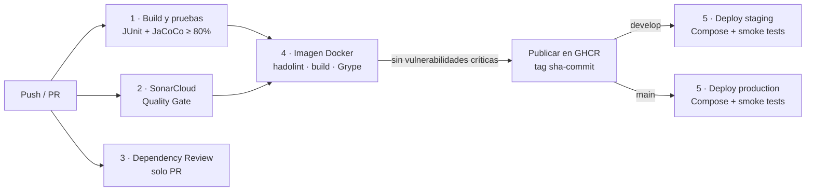

# Microservicio Pokémon


## 1. Descripción

Microservicio CRUD de Pokémon desarrollado con Spring Boot.

El repositorio forma parte de las evaluaciones de la asignatura **Ingeniería DevOps**:

* **Evaluación Parcial N°1:** control de versiones, estrategia de branching (GitFlow) y CI básica.
* **Evaluación Parcial N°2:** pipeline CI/CD completo en GitHub Actions con contenedores, pruebas automatizadas, análisis de seguridad, despliegue automático en un entorno simulado y orquestación con Docker Compose (secciones 10 a 17).

---

## 2. Integrantes

* Nombre: Diego Araya
* Nombre: Leonardo Mendez
* Nombre: Cristopher López

---

## 3. Tecnologías utilizadas

* Java 21 / Spring Boot 3.5 / Maven
* PostgreSQL: Supabase (nube) en production y AWS EC2; contenedor PostgreSQL 16 en local y staging
* JUnit 5, Mockito, MockMvc y JaCoCo (pruebas y cobertura)
* Docker (imagen multi-stage) y Docker Compose (orquestación)
* Nginx (gateway y balanceador de carga)
* GitHub Actions (CI/CD) y GitHub Container Registry (GHCR)
* SonarCloud (análisis estático), Dependabot y Grype (seguridad de dependencias e imagen)
* Swagger / OpenAPI
* Git / GitHub

---


# 4. Estrategia de branching

Para el desarrollo colaborativo se utilizamos GitFlow, este nos permitio colaborar en distintas ramas. mientras unos subian el codigo base, el otro desarrollaba otra funcionalidad.
Se eligió GitFlow en lugar de Trunk-Based Development debido a que el proyecto requiere una separación clara entre el código estable y el código en desarrollo,

La estructura utilizada será:

main
│
└── develop
    ├── feature/getbyname
    ├── feature/deletebyname
    └── hotfix/errordeprueba
    └── hotfix/endpoints-duplicados


### Ramas principales

#### `main`

Contiene la versión base y ejecutable del proyecto.

Los cambios hacia main se realizan mediante Pull Requests desde la rama develop y deben ser revisados (github tiene un compilador para probar que no haya conflicto de codigo) antes de realizar el merge.

#### `develop`

Contiene la versión de desarrollo donde se integran las nuevas funcionalidades desde las ramas features mediane pull request

#### `feature/nombrefuncionalidad`

Se utiliza para desarrollar nuevas funcionalidades.

Ejemplos:
feature/gebyname
feature/deletebyname
feaure/swagger


Una vez terminada la funcionalidad, se crea un Pull Request hacia la rama develop.

#### `hotfix/<nombre>`

Se utiliza para solucionar errores criticos de manera rapida y se integra mediante pull request a la rama correspondiente.
Generalmente se integra en varias ramas para corregir el error, por ejemplo primero se hace el pullrequest al feature y luego al develop.

Ejemplos:
hotfix/errortipeo
hotfix/errorversion
hotfix/errorcodigoduplicado


Los cambios del hotfix deben ser revisados mediante Pull Request antes de integrarse a la rama correspondiente.

---

# 5. Convención de nombres de ramas

Se utilizará la siguiente nomenclatura:

feature/<funcionalidad>
hotfix/<error>


Los nombres deben:

* Estar escritos en minúsculas.
* Utilizar palabras descriptivas.
* Separar palabras mediante `-`.
* Indicar claramente el objetivo del cambio.

Ejemplos:

feature/create-pokemon
feature/delete-pokemon
hotfix/errorcontroller
hotfix/fix-delete-mapping


---

# 6. Convención de commits

Se utilizará una convención basada en Conventional Commits.

Formato:

tipo: descripción

Tipos principales:

  feat      Nueva funcionalidad                
  fix       Corrección de errores              


Ejemplos:

feat: agregar endpoint para eliminar pokemon

fix: corregir mapping de delete por nombre


Los mensajes de commit deben ser claros, breves y describir el cambio realizado.

---

# 7. Flujo de trabajo

El flujo de trabajo definido para el proyecto será:


feature/<funcionalidad>
       ↓
     develop
       ↓
      main


Para desarrollar una nueva funcionalidad:

1. Crear una rama feature/<funcionaliadad> desde develop.
2. Realizar los cambios necesarios.
3. Crear commits descriptivos.
4. Realizar `push` de la rama a GitHub.
5. Crear un Pull Request hacia `develop`.
6. Realizar la revisión del código.
7. Corregir las observaciones realizadas durante la revisión.
8. Aprobar el Pull Request.
9. Realizar el merge hacia `develop`.

Para una corrección urgente:


hotfix/<error>
       ↓
     develop


El hotfix debe ser revisado mediante Pull Request antes de integrarse.

---

# 8. Pull Requests

Todos los cambios realizados mediante ramas `feature` y `hotfix` deben integrarse utilizando Pull Requests.

Cada Pull Request debe contener:

* Título descriptivo.
* Descripción del cambio realizado.
* Rama de origen.
* Rama de destino.
* Revisión por otro integrante del equipo.

No se deben realizar cambios directamente sobre `main`.

---

# 9. Estrategia de revisión

La revisión de código se realizará mediante **Pull Requests de GitHub**.

El integrante que no desarrolló directamente el cambio deberá revisar el Pull Request.

Durante la revisión se verificará:

* Funcionamiento del código.
* Cumplimiento de las convenciones de commits.
* Correcta nomenclatura de ramas.
* Calidad y legibilidad del código.
* Ausencia de errores evidentes.
* Correcta implementación de la funcionalidad.

Si existen observaciones, estas deberán ser corregidas antes de realizar el merge.

---

# 10. Pipeline CI/CD (GitHub Actions)

El pipeline está definido en `.github/workflows/ci-cd.yml` y el despliegue en el workflow reutilizable `.github/workflows/deploy.yml`.

## 10.1 Disparadores

| Evento | Qué se ejecuta |
|---|---|
| Pull Request hacia `develop` o `main` | Build y pruebas, SonarCloud, revisión de dependencias y build + escaneo de la imagen (no se publica ni se despliega) |
| Push / merge a `develop` | Build y pruebas, imagen Docker con escaneo y **despliegue automático en `staging`** (2 réplicas). SonarCloud ya se ejecutó en el PR. |
| Push / merge a `main` | Pipeline completo y **despliegue automático en `production`** (3 réplicas) |
| Manual (`workflow_dispatch`) | Pipeline completo sobre la rama elegida |

## 10.2 Etapas



| # | Job | Indicador | Qué hace | Bloquea si... |
|---|---|---|---|---|
| 1 | Build y pruebas unitarias | IE2 | `mvn verify`: compila, ejecuta las pruebas JUnit, genera el reporte JaCoCo y verifica la cobertura mínima. Publica los reportes y el JAR como artefactos. | falla una prueba o la cobertura de líneas es menor a 80 % |
| 2 | Análisis SonarCloud | IE3 | Análisis estático (bugs, vulnerabilidades, code smells, security hotspots y cobertura) y espera el resultado del Quality Gate. Corre en cada PR y en cada push a `main`. El plan gratuito de SonarCloud no analiza otras ramas, pero todo lo que entra a `develop` ya pasó el Quality Gate en su PR. | el Quality Gate no se aprueba |
| 3 | Revisión de dependencias | IE3 | En cada PR compara las dependencias nuevas contra la base de vulnerabilidades de GitHub. | se agrega una dependencia con vulnerabilidad alta o crítica |
| 4 | Imagen Docker | IE1, IE3, IE4 | Lint del Dockerfile (hadolint), construcción de la imagen, escaneo con Grype, publicación en GHCR con SBOM y procedencia. | hay errores en el Dockerfile o vulnerabilidades críticas con parche disponible |
| 5 | Deploy staging / production | IE4, IE5 | Levanta el stack completo con Docker Compose usando la imagen publicada, ejecuta smoke tests y una prueba de autorrecuperación, y registra la trazabilidad. | el stack no queda sano o falla algún smoke test |
| 6 | Deploy AWS EC2 | IE4, IE5 | Después de production, copia la configuración a la instancia EC2 por SSH, instala Docker si falta, descarga la imagen exacta desde GHCR, levanta el stack con Docker Compose y ejecuta los smoke tests contra la IP pública. Si los secrets de EC2 no existen, se omite con un aviso. | el stack no queda sano en la instancia o falla algún smoke test |

Cada job depende del anterior (`needs`): si una etapa falla, las siguientes no se ejecutan y la imagen **no** se publica ni se despliega.

---

# 11. Contenerización (Dockerfile)

El `Dockerfile` es **multi-stage**:

1. **build** (`maven:3.9-eclipse-temurin-21`): descarga dependencias (capa cacheada si `pom.xml` no cambia) y compila el JAR.
2. **extract**: separa el JAR en capas de Spring Boot (dependencias, loader y código de la aplicación).
3. **runtime** (`eclipse-temurin:21-jre-alpine`): solo JRE y las capas extraídas.

Características:

* La imagen final no contiene JDK, Maven ni código fuente.
* Corre con un **usuario sin privilegios** (UID 10001).
* Tiene un `HEALTHCHECK` sobre `/actuator/health/liveness`.
* La JVM se ajusta a los límites de memoria del contenedor (`MaxRAMPercentage=75`) y se reinicia limpiamente ante un `OutOfMemoryError`.
* Lleva labels OCI (`org.opencontainers.image.revision`, `version`, `created`) con el commit de origen.
* Un `.dockerignore` excluye `.git`, `.env`, `target/` y otros archivos del contexto de build.

Construir y ejecutar solo la imagen:

```bash
docker build -t pokemon-service:local --build-arg GIT_COMMIT=$(git rev-parse HEAD) .
```

---

# 12. Orquestación con Docker Compose

`docker-compose.yml` define el stack completo:

```
             puerto 8080
cliente ───────► gateway (Nginx) ──┬──► app réplica 1 ──┐
                 red frontend      ├──► app réplica 2 ──┼──► db (PostgreSQL 16)
                                   └──► app réplica N ──┘
                                    red backend (interna, sin salida a Internet)
```

| Servicio | Imagen | Rol |
|---|---|---|
| `gateway` | `nginxinc/nginx-unprivileged:1.28-alpine` | Único punto de entrada. Balancea con `least_conn` entre las réplicas, reintenta en otra réplica si una falla, limita la tasa por IP (20 req/s), agrega cabeceras de seguridad y solo expone `health` e `info` del actuator. |
| `app` | `ghcr.io/<repo>:sha-<commit>` o build local | Microservicio. Tiene `APP_REPLICAS` réplicas (2 por defecto) y no publica puertos al host. |
| `db` | `postgres:16-alpine` | Base de datos con volumen persistente. Se inicializa con `schema.sql`. No es accesible desde fuera. |

**Escalabilidad:**

* Las réplicas se definen con `deploy.replicas`. Para escalar en caliente: `docker compose up -d --scale app=3 --wait`.
* Nginx detecta las nuevas réplicas mediante el DNS interno de Docker (`resolve`), sin reiniciarse.
* Cada contenedor tiene límites y reservas de CPU y memoria.
* El pool de conexiones a la base está acotado para que N réplicas no agoten las conexiones de PostgreSQL.

**Disponibilidad:**

* Cada servicio tiene healthcheck. `depends_on: condition: service_healthy` asegura el orden de arranque `db → app → gateway`.
* La política `restart: unless-stopped` reinicia los contenedores caídos.
* El apagado es graceful (`server.shutdown: graceful` y `stop_grace_period`).

**Seguridad de los contenedores:**

* Filesystem de solo lectura (`read_only` con `/tmp` en tmpfs).
* `cap_drop: ALL` y `no-new-privileges`.
* Procesos sin root.
* Red `backend` interna.
* Las credenciales se pasan por variables de entorno, nunca dentro de la imagen.
* Rotación de logs (10 MB × 3).

### Ejecución local

```bash
cp .env.example .env        # editar POSTGRES_PASSWORD
docker compose up -d --build --wait
./scripts/smoke-test.sh     # verificación rápida (requiere curl y jq)
```

* API: http://localhost:8080/api/pokemons
* Swagger: http://localhost:8080/swagger-ui.html
* Salud: http://localhost:8080/actuator/health
* Versión desplegada: http://localhost:8080/actuator/info

Para detener el stack: `docker compose down` (agregar `-v` para borrar también los datos).

---

# 13. Despliegue automático en entorno simulado

El workflow `deploy.yml` usa el runner de GitHub Actions como "servidor cloud" simulado:

1. Inicia sesión en GHCR y descarga la imagen **exacta** que pasó las pruebas y el escaneo (`sha-<commit>`). La imagen no se reconstruye.
2. Genera una contraseña aleatoria para la base de datos (enmascarada en los logs) y la escribe en un `.env` temporal.
3. Ejecuta `docker compose up --no-build --wait`, que espera a que todos los servicios estén sanos.
4. Ejecuta `scripts/smoke-test.sh`, que verifica:
   * la salud del servicio;
   * que el commit expuesto en `/actuator/info` sea el mismo que disparó el pipeline;
   * el CRUD completo de punta a punta, incluida la validación (400) y el 404;
   * que el gateway reparta carga entre todas las réplicas.
5. **Prueba de autorrecuperación:** elimina una réplica, comprueba que la API sigue respondiendo y que Compose restaura el número de réplicas.
6. Publica un resumen del despliegue y los logs de los contenedores como artefacto, y apaga el entorno.

Los entornos `staging` y `production` quedan registrados en **GitHub → Environments / Deployments**, con su historial de despliegues.

---

# 14. Trazabilidad y calidad

### Trazabilidad (desde el commit hasta lo desplegado)

| Elemento | Cómo se vincula al commit |
|---|---|
| Imagen Docker | Tag inmutable `sha-<7 caracteres>`, más los tags `develop`/`main`/`latest` |
| Contenido de la imagen | Labels OCI `revision` y `created`, SBOM y attestation de procedencia (build provenance) en GHCR |
| Aplicación en ejecución | `/actuator/info` muestra `commit`, `version` y `environment`. Los smoke tests verifican que coincida con el commit del pipeline. |
| Reportes | Artefactos `test-reports-<sha>`, `pokemon-service-jar-<sha>` y `deploy-logs-<entorno>-<sha>` (30 días) |
| Despliegues | GitHub Environments (quién, cuándo, qué commit) y la tabla en el *Job Summary* de cada ejecución (commit, imagen, digest, réplicas, autor) |
| Cambios de código | GitFlow con Pull Requests y Conventional Commits (secciones 4 a 9) |

### Calidad y seguridad

* **Pruebas automatizadas** (JUnit 5 + Mockito + MockMvc):
  * `PokemonServiceTest`: lógica de negocio, incluidos los casos de "no encontrado".
  * `PokemonControllerTest`: códigos HTTP, validaciones (400), errores 404/500 y formato de respuesta.
* **Política de cobertura:** JaCoCo exige al menos **80 % de líneas** (configurable en `pom.xml`, propiedad `jacoco.minimum.line.coverage`). Se excluyen DTOs, entidades y configuración.
* **Análisis estático:** Quality Gate de SonarCloud obligatorio.
* **Dependencias:**
  * Dependabot revisa cada semana Maven, imágenes Docker, Docker Compose y GitHub Actions, y abre PRs hacia `develop`.
  * Dependency Review bloquea los PRs que agreguen dependencias vulnerables.
* **Cadena de suministro del pipeline:** las acciones de terceros (Docker, Anchore) están fijadas por hash de commit y no por etiqueta, para que nadie pueda cambiar su código sin que se note (Dependabot las mantiene actualizadas). Los valores dinámicos se pasan a los comandos como variables de entorno para evitar inyección de comandos.
* **Imagen:** hadolint para buenas prácticas del Dockerfile y Grype para vulnerabilidades. Las críticas con parche bloquean la publicación; el resto queda como **alerta** en *Security → Code scanning*.
* **Alertas:** cuando un job falla, GitHub notifica por correo al autor del commit. Los hallazgos de seguridad aparecen en la pestaña *Security* y los de SonarCloud en su panel (y como comentario en el PR).
* **Secretos:**
  * Se eliminaron las credenciales por defecto de `application.yml`.
  * Los secretos se gestionan con GitHub Secrets y `.env` (ignorado por Git).
  * Los permisos del `GITHUB_TOKEN` son mínimos, definidos por job.

---

# 15. Configuración necesaria en GitHub

Pasos previos para que el pipeline funcione:

1. **SonarCloud**
   1. Ingresar a https://sonarcloud.io con la cuenta de GitHub e importar el repositorio.
   2. En el proyecto: *Administration → Analysis Method* → desactivar **Automatic Analysis** (el análisis lo hace el pipeline).
   3. *My Account → Security* → generar un token.
   4. En GitHub (*Settings → Secrets and variables → Actions*):
      * **Secret** `SONAR_TOKEN`: el token generado.
      * **Variable** `SONAR_ORGANIZATION`: la key de la organización en SonarCloud.
      * **Variable** `SONAR_PROJECT_KEY`: la key del proyecto (por ejemplo `usuario_Pokemon-Microservicio`).
2. **Dependabot:** en *Settings → Code security* activar *Dependency graph*, *Dependabot alerts* y *Dependabot security updates*. Las actualizaciones de versión se configuran en `.github/dependabot.yml`.
3. **Environments** (*Settings → Environments*): crear `staging` y `production`. Opcionalmente, en `production` agregar *Required reviewers* para exigir una aprobación manual antes de desplegar.
4. **Protección de ramas** (*Settings → Branches*) para `main` y `develop`: exigir PR y que pasen los checks `1 · Build y pruebas unitarias`, `2 · Análisis SonarCloud (Quality Gate)` y `4 · Imagen Docker`.
5. **AWS EC2 (laboratorio AWS Academy)**
   * **Secret** `EC2_HOST`: IP pública de la instancia.
   * **Secret** `EC2_SSH_KEY`: contenido completo de la llave privada `.pem` (desde `-----BEGIN` hasta `-----END`).
   * **Variable** `EC2_USER` (opcional): `ec2-user` en Amazon Linux (valor por defecto) o `ubuntu` en Ubuntu.
   * **Variable** `EC2_APP_REPLICAS` (opcional): réplicas en la instancia (por defecto 2).
   * Security group con entrada **22 (SSH)** y **80 (HTTP)** abiertas. Instancia **x86_64** con al menos **2 GB de RAM** (t3.small o mayor); con 1 GB usar `EC2_APP_REPLICAS=1`.
   * Al cambiar la instancia (nuevo laboratorio) basta con actualizar `EC2_HOST` y `EC2_SSH_KEY`.
6. **Supabase (base de datos en la nube para production y EC2)**
   * Crear el proyecto en https://supabase.com y ejecutar `schema.sql` en el **SQL Editor**.
   * En **Connect → Session pooler** copiar host, usuario y puerto (el pooler funciona por IPv4, la conexión directa no).
   * **Secret** `SUPABASE_DB_URL`: `jdbc:postgresql://<host-del-pooler>:5432/postgres?sslmode=require`
   * **Secret** `SUPABASE_DB_USER`: `postgres.<id-del-proyecto>`
   * **Secret** `SUPABASE_DB_PASSWORD`: la clave de la base.
   * Staging y el entorno local siguen usando PostgreSQL en contenedor (datos de prueba desechables). Si faltan estos secrets, production y EC2 también usan PostgreSQL local y el pipeline lo advierte.

---

# 16. Estructura del repositorio

```
.
├── .github/
│   ├── dependabot.yml          # actualizaciones automáticas de dependencias
│   └── workflows/
│       ├── ci-cd.yml           # pipeline principal
│       └── deploy.yml          # despliegue reutilizable (staging / production)
├── deploy/
│   └── nginx/default.conf      # gateway / balanceador
├── scripts/
│   ├── smoke-test.sh           # verificación post-despliegue (bash, usado por el pipeline)
│   └── smoke-test.ps1          # misma verificación para Windows / PowerShell
├── src/
│   ├── main/java/com/pokemon/  # controller, service, repository, dto, entity, exception
│   └── test/java/com/pokemon/  # PokemonServiceTest, PokemonControllerTest
├── Dockerfile                  # imagen multi-stage
├── .dockerignore
├── docker-compose.yml          # orquestación: gateway + réplicas + PostgreSQL
├── .env.example                # plantilla de variables (copiar a .env)
├── schema.sql                  # tabla, datos iniciales y secuencia
└── pom.xml                     # dependencias, JaCoCo y propiedades de Sonar
```

---

# 17. Ejecución del proyecto sin contenedores

Requisitos: Java 21, Maven y acceso a una base de datos PostgreSQL configurada en `.env` (ver `.env.example`).

```bash
git clone <URL_DEL_REPOSITORIO>
cd <NOMBRE_DEL_REPOSITORIO>
mvn spring-boot:run
```

Ejecutar las pruebas con el reporte de cobertura:

```bash
mvn verify
# reporte HTML: target/site/jacoco/index.html
```

---

# 18. API

La API permite realizar operaciones CRUD sobre Pokémon.

```
GET     /api/pokemons
GET     /api/pokemons/{id}
GET     /api/pokemons/name/{name}
POST    /api/pokemons
PUT     /api/pokemons/{id}
DELETE  /api/pokemons/{id}
DELETE  /api/pokemons/name/{name}
```

La documentación de la API se puede consultar con Swagger/OpenAPI en `/swagger-ui.html`.

---

# 19. Justificación de decisiones técnicas

> _A completar por el equipo, sin apoyo de IA (requisito de la pauta)._

---

# 20. Declaración de uso de Inteligencia Artificial

> _A completar por el equipo: qué herramientas de IA se usaron, para qué partes del trabajo y cómo se revisó y validó el contenido generado. Citar según https://bibliotecas.duoc.cl/ia_

---

# 21. Conclusiones y reflexiones individuales

> _A completar por cada integrante, sin apoyo de IA (requisito de la pauta)._

### Diego Araya

### Leonardo Mendez

### Cristopher López
